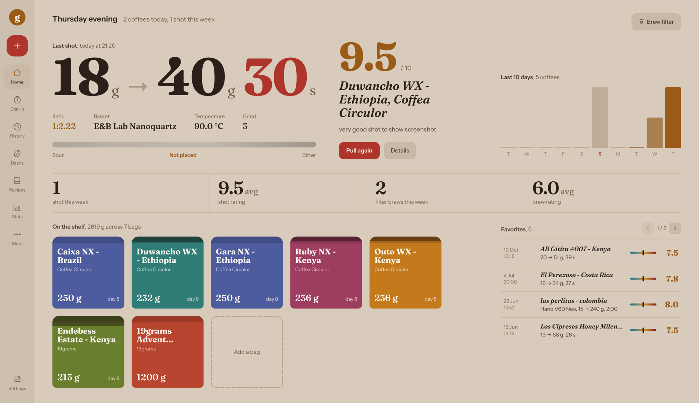
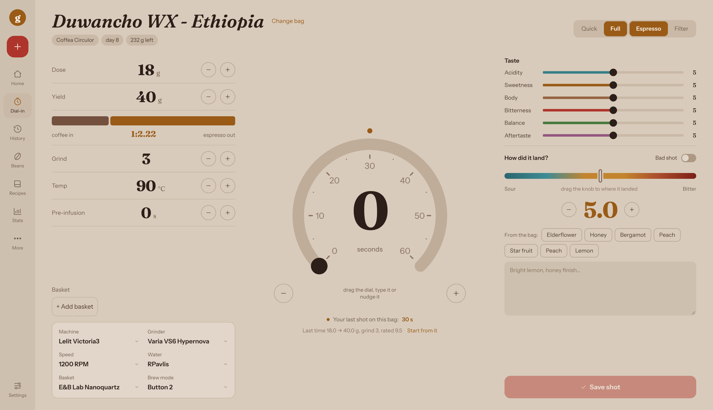
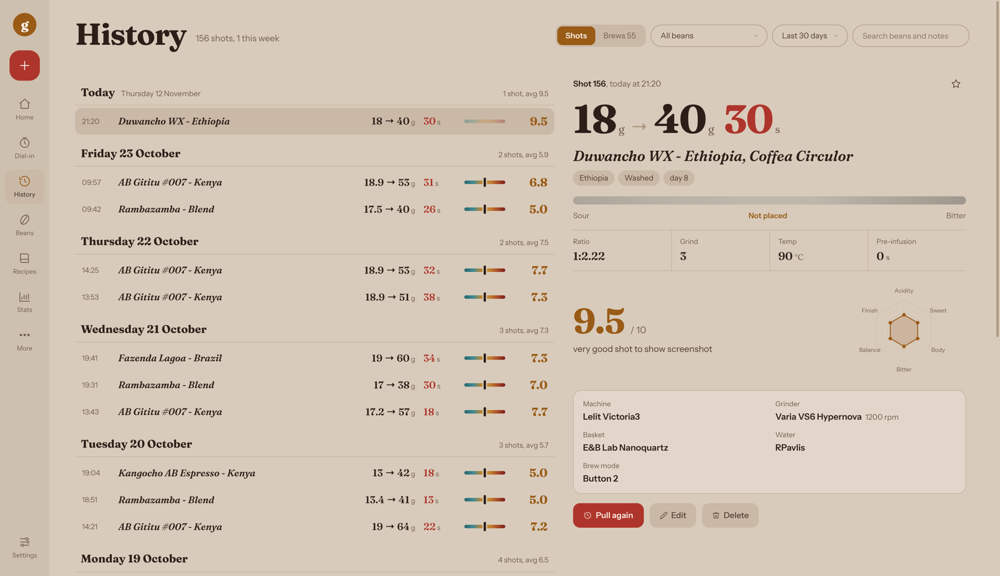
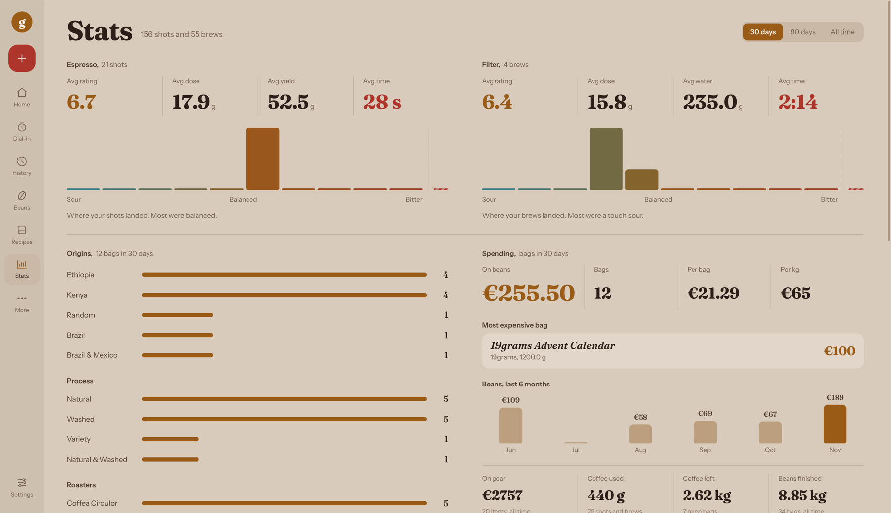
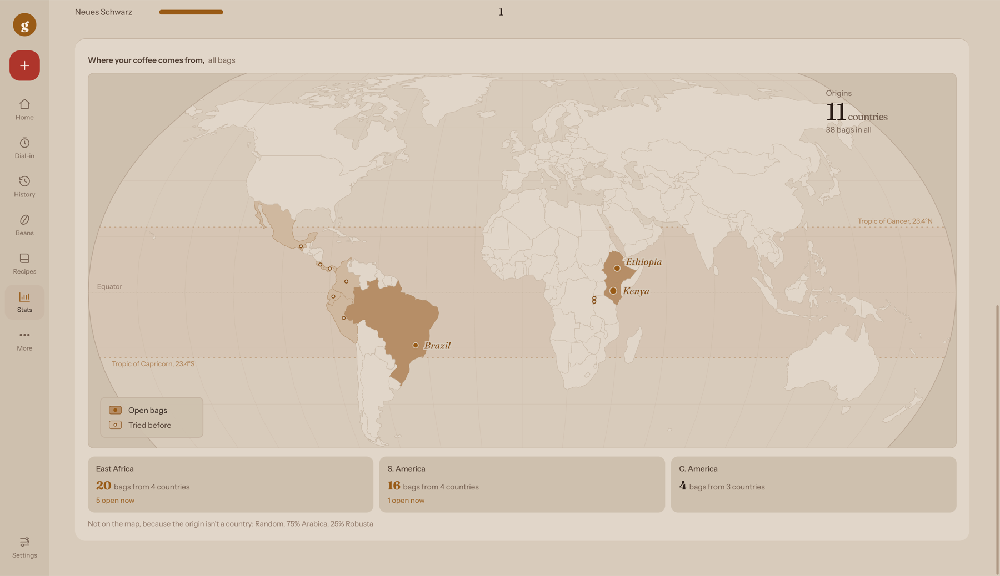
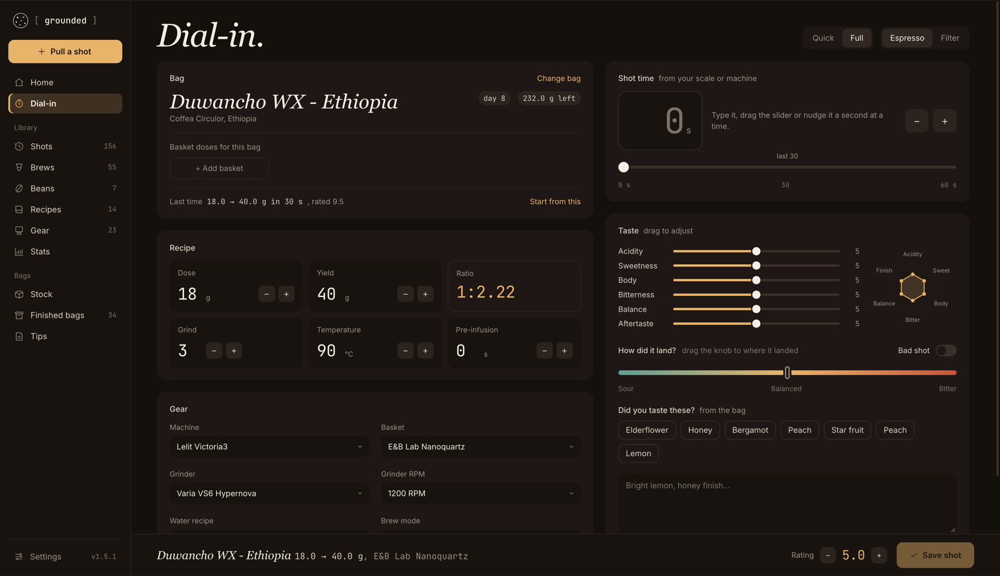
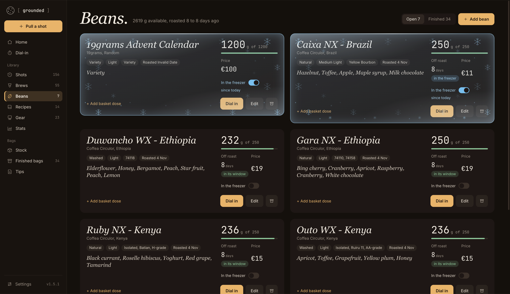
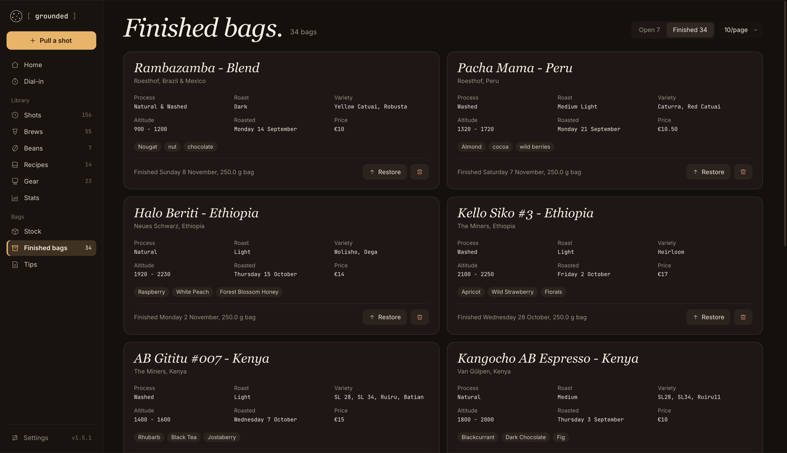
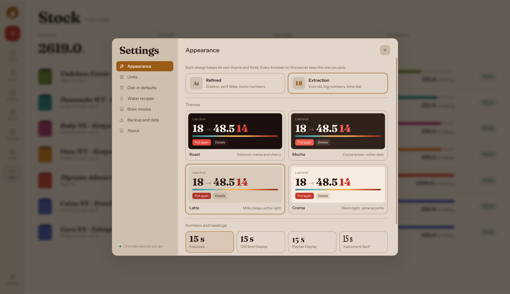

# Grounded ☕

A self-hosted espresso & filter coffee tracker. Log shots and brews while you dial in, keep a library of beans, gear and recipes, and see how your coffee is trending over time.

React + Express + SQLite in a single Docker container. No accounts, no cloud, no telemetry — your data stays in one SQLite file on your own machine.



---

## Features

- **Dial-in** — espresso and filter modes. Log dose, yield, time, temperature, grind, pre-infusion, grinder RPM, basket, water recipe and brew mode, enter the time by hand (no timer), mark where the cup landed between sour and bitter (or check **Bad shot**), and rate it on six taste axes with a live flavor radar.
- **Quick log** — for the phone at the machine: the bag, dose, out and time as big numbers with − / +, starting from your last shot with that bag. Save it untasted and add taste later.
- **Basket doses** — save the dose you measured for each basket per bean, along with the grind setting it was measured at, and apply it with one click.
- **Shots & brews** — grouped by day, filtered by bag, period and notes; edit, favorite and re-use past ones as a starting point for the next.
- **Beans** — roaster, origin, process, variety, roast date, tasting notes, price and remaining stock. Mark a bag as **in the freezer** and it stops aging while it's frozen. Move finished bags to **Finished bags**.
- **A page for each bag** — freshness, what's left, your best shot so far, your grind across the bag, your rating by days off roast, and every shot and brew you made with it.
- **Stock** — open bags, low-stock warnings and spending.
- **Recipes & tips** — store your own brew recipes and notes.
- **Gear** — machines, grinders, baskets, drippers, scales and kettles. Active gear feeds the dial-in dropdowns.
- **Care** — maintenance reminders for each machine, grinder or other gear, every so many shots, days or kg of coffee (backflush, descale, clean burrs…), counted from the shots and brews you log, with a log of every time you did it. Home shows the ones that are due.
- **Stats** — where your shots landed between sour and bitter, rating per day, espresso per basket, origins (with a world map), spending, how much coffee you've used and have left, and how much you've finished.
- **Works on a phone** — the same page in your phone's browser, with a tab bar at the bottom.
- **Settings** — two designs: Refined (a sidebar, serif titles, six themes: Moody, Midnight, Terminal, Parchment, Oat, Ember) and Extraction (an icon rail, big numbers, a time dial, and the Roast, Mocha, Latte and Crema themes), each with its own choice of bundled fonts, g/oz and °C/°F units, € / $ / £ for prices, default dial-in values and custom water recipes. Settings are stored on the server, so every browser and device sees the same ones.

---

## Screenshots

Grounded comes in two designs, each with its own themes. You switch between them in Settings.

**Extraction** — an icon rail, big numbers and a time dial (Latte theme shown)

| | |
|---|---|
| <br>Dial-in | <br>History |
| <br>Stats | <br>Origins map |

**Refined** — a sidebar, serif titles and mono numbers (Moody theme shown)

| | |
|---|---|
| <br>Dial-in | <br>Beans, two of them in the freezer |
| <br>Finished bags | <br>Settings → Appearance |

---

## Quick start (Docker)

The easiest way is the ready-made image (amd64 and arm64). Make a folder for Grounded with this `docker-compose.yml` in it:

```yaml
services:
  grounded:
    image: ghcr.io/adnn-alc/grounded:1
    container_name: grounded
    ports:
      - "5555:3001"   # host:container
    volumes:
      - ./data:/app/data
    restart: unless-stopped
```

Then start it from that folder:

```bash
docker compose up -d
```

and open **http://localhost:5555**.

The `1` tag follows every 1.x release. Use an exact version such as `1.5.0` to stay on one, or `latest`.

Without Compose, the same thing is:

```bash
docker run -d --name grounded -p 5555:3001 -v "$PWD/data:/app/data" --restart unless-stopped ghcr.io/adnn-alc/grounded:1
```

The database is stored at `./data/grounded.db` next to `docker-compose.yml`, so it survives container rebuilds and updates. On first run it is created and filled with a few sample beans, shots and gear to explore. When you're ready to log your own, use **Remove sample data** in the banner on the Home page. It removes only the samples, never anything you added, and the banner disappears for good once you've removed or kept them.

To use a different host port, change the left side of the port mapping in `docker-compose.yml`:

```yaml
ports:
  - "8080:3001"   # host:container
```

### Building from source instead

```bash
git clone https://github.com/adnn-alc/grounded.git
cd grounded
docker compose up -d --build
```

The repository's `docker-compose.yml` builds the image from the code instead of pulling it.

### Updating

With the image:

```bash
docker compose pull
docker compose up -d
```

Built from source:

```bash
git pull
docker compose up -d --build
```

When an update changes the database layout, Grounded saves a copy of your database first (see [Backup & restore](#backup--restore)).

Grounded runs as the unprivileged `node` user (uid 1000) inside the container, not as root. On start it makes the `data/` folder belong to uid 1000 and then drops its root rights. So a folder created by an older version (which ran as root) keeps working, and you don't need to change ownership yourself. If you'd rather run it as your own user, set `user: "UID:GID"` in `docker-compose.yml` and make sure that user can write to `data/`.

---

## Local development

Requires Node 22.18+ (Node 24 LTS recommended — it's what the Docker image uses). The API is TypeScript that Node runs directly, so there is no server build step.

```bash
npm install
npm run dev
```

This starts both servers:

- **Vite UI** → http://localhost:5173
- **Express API** → http://localhost:3001

Vite proxies `/api/*` to Express, so there's no CORS setup needed. The dev database is created at `data/grounded.db`.

| Command           | What it does                                        |
|-------------------|-----------------------------------------------------|
| `npm run dev`     | UI + API together                                   |
| `npm run dev:ui`  | Vite only                                           |
| `npm run dev:api` | Express only (restarts on file changes)             |
| `npm run build`   | Build the frontend into `dist/`                     |
| `npm start`       | Run the API; with `NODE_ENV=production` it also serves `dist/` |
| `npm run lint`    | Lint with oxlint                                    |
| `npm run typecheck` | Type-check the UI and the API                     |
| `npm test`        | Run the API tests (Node 24)                         |

### Running without Docker

```bash
npm install
npm run build
NODE_ENV=production npm start
```

Everything is served from one port (3001 by default).

---

## Configuration

| Variable   | Default             | Description                                          |
|------------|---------------------|------------------------------------------------------|
| `PORT`     | `3001`              | Port the server listens on                           |
| `DB_PATH`  | `data/grounded.db`  | Path to the SQLite database file                     |
| `NODE_ENV` | —                   | Set to `production` to serve the built frontend (the Docker image already does) |
| `ALLOWED_HOSTS` | — (off)        | Optional. Comma-separated host names/IPs Grounded answers to, e.g. `nas.local,192.168.1.20,grounded.example.com`. Blocks DNS-rebinding attacks from malicious websites. `localhost` always works. |

With Docker, set them under `environment:` in `docker-compose.yml`, e.g. `- ALLOWED_HOSTS=nas.local,192.168.1.20`.

---

## Backup & restore

The easiest way is in the app: **Settings → Backup & data**.

- **Download a backup** saves everything (beans including archived ones, shots, brews, gear, recipes, notes, care tasks and their log, and settings) in one `.json` file. Keep it somewhere other than the server.
- **Restore from a backup** shows what the file would change before anything happens, then either:
  - **Add missing**: keeps everything you have and adds what the backup has that this install doesn't. Nothing is overwritten. Handy for merging a second install into your main one.
  - **Replace everything**: deletes what's there now and loads the backup, settings included. For a new server or a wiped install.

  Before restoring, Grounded saves a copy of the current database next to it (`data/grounded.db.backup-import-…`), and the whole restore succeeds or changes nothing. Backups from older Grounded versions work; a backup from a newer version asks you to update first.
- **Spreadsheet export** downloads your shots or brews as CSV for Excel, Numbers or Google Sheets.

Stock amounts come from the backup as they were; restoring doesn't recount them from the shots.

You can also copy the database file itself. Everything is in the `data/` folder. SQLite runs in WAL mode, so stop the container before copying to get a consistent snapshot:

```bash
docker compose stop
cp data/grounded.db ~/grounded-backup-$(date +%F).db
docker compose start
```

When an update changes the database layout, Grounded first saves a copy next to it automatically (`data/grounded.db.backup-v…`). You can delete those copies, and the `backup-import-…` ones, once you're happy.

To restore a copied file, stop the container, put the backup back at `data/grounded.db` (and remove any `grounded.db-wal` / `grounded.db-shm` files next to it), then start it again.

---

## Security

Grounded has **no login or authentication** — anyone who can reach the port can view and edit all data. It's meant for a home network. If you expose it to the internet, put it behind a reverse proxy with authentication (e.g. Nginx Proxy Manager access lists, Authelia, or a VPN like Tailscale).

For extra protection on a home network, set `ALLOWED_HOSTS` (see [Configuration](#configuration)) to every address you open Grounded with. Then a malicious website can't use your browser to reach it.

Grounded doesn't block being shown inside a frame, so you can embed it in a home dashboard.

Found a security problem? Please report it privately — see [SECURITY.md](SECURITY.md).

---

## Project structure

```
grounded/
├── Dockerfile              # Multi-stage build: builds the UI, runs the API
├── docker-compose.yml      # Builds from source (the quick start above uses the image)
├── .github/                # CI, release image, Dependabot, issue templates
├── tsconfig.json           # Type-checking for the UI (strict)
├── server/
│   ├── index.ts            # Starts the server, clean shutdown
│   ├── app.ts              # Express API — all routes
│   ├── db.ts               # SQLite schema, migrations, seed data
│   ├── backup.ts           # Backup export/restore, CSV export
│   ├── validation.ts       # Request checks (zod)
│   ├── errors.ts           # Error handling
│   ├── *.test.ts           # API, backup and migration tests (npm test)
│   └── tsconfig.json       # Type-checking for the API
├── src/
│   ├── types.ts            # Types shared by the API and the UI
│   ├── App.tsx             # Hash routing, theme, settings
│   ├── api/client.ts       # All fetch() calls
│   ├── hooks/
│   │   ├── useData.ts      # Loads all data, exposes mutation helpers
│   │   └── useUnits.ts     # g/oz and °C/°F helpers
│   ├── pages/              # One file per page: Home, Dial-in, histories, beans, gear, stats…
│   ├── components/         # Shell, charts, settings, world map, basket doses
│   ├── data/               # Static data and helpers (world map, fonts, beans, care, taste)
│   └── styles/             # global.css (Refined, themes via CSS custom properties), extraction.css
├── scripts/
│   └── build-world-map.mjs # Regenerates src/data/worldMap.ts
└── docs/
    └── screenshots/        # The pictures in this README
```

---

## API

All endpoints are JSON under `/api`.

| Resource | Endpoints |
|----------|-----------|
| Shots    | `GET /shots` · `POST /shots` · `PUT /shots/:id` · `DELETE /shots/:id` · `PATCH /shots/:id/favorite` |
| Brews    | `GET /brews` · `POST /brews` · `PUT /brews/:id` · `DELETE /brews/:id` · `PATCH /brews/:id/favorite` |
| Beans    | `GET /beans` · `GET /beans/archived` · `POST /beans` · `PUT /beans/:id` · `DELETE /beans/:id` |
| Gear     | `GET /gear` · `POST /gear` · `PUT /gear/:id` · `DELETE /gear/:id` |
| Recipes  | `GET /recipes` · `POST /recipes` · `PUT /recipes/:id` · `DELETE /recipes/:id` |
| Tips     | `GET /tips` · `POST /tips` · `PUT /tips/:id` · `DELETE /tips/:id` |
| Care     | `GET /care-tasks` · `POST /care-tasks` · `PUT /care-tasks/:id` · `DELETE /care-tasks/:id` · `POST /care-tasks/:id/done` · `GET /care-log` · `DELETE /care-log/:id` (undo a Done) |
| Settings | `GET /settings` · `PUT /settings` (partial update) |
| Sample data | `POST /sample-data/clear` (only while the sample data is there) |
| Backup   | `GET /export` (JSON backup) · `GET /export/shots.csv` · `GET /export/brews.csv` · `POST /import` (`{ mode: "replace" \| "merge", dryRun?, backup }`) |
| Health   | `GET /health` |

---

## Tech stack

| Layer    | Choice                                      |
|----------|---------------------------------------------|
| Language | TypeScript (strict)                         |
| UI       | React 18 + Vite 8                           |
| API      | Express 4                                   |
| Database | SQLite via better-sqlite3                   |
| Styling  | Plain CSS with custom properties            |
| Charts   | Hand-rolled SVG                             |
| Fonts    | Bundled via Fontsource (Geist, Geist Mono, Instrument Serif on Refined; Fraunces, Instrument Sans on Extraction) |
| Deploy   | Docker / Docker Compose                     |

---

## Versioning

Grounded uses [Semantic Versioning](https://semver.org/). Every release is a git tag (`v1.0.0`, `v1.1.0`, …) and is listed in [CHANGELOG.md](CHANGELOG.md). The current version is shown in the sidebar and under Settings → About.

To cut a release:

```bash
npm version minor     # or patch / major — bumps package.json + lock, commits and tags
git push --follow-tags
```

---

## Contributing

Bug reports, ideas and pull requests are welcome. See [CONTRIBUTING.md](CONTRIBUTING.md) for how to run it locally and what a pull request needs, and [CODE_OF_CONDUCT.md](CODE_OF_CONDUCT.md). Security problems go through [SECURITY.md](SECURITY.md).

---

## License

Copyright (C) 2026 adnn-alc

Grounded is free software: you can redistribute it and/or modify it under the terms of the [GNU Affero General Public License v3.0](LICENSE) or (at your option) any later version.

In short: you're free to use, modify and self-host it. If you distribute a modified version — or run a modified version as a service that other people use over a network — you must make your source code available under the same license.
